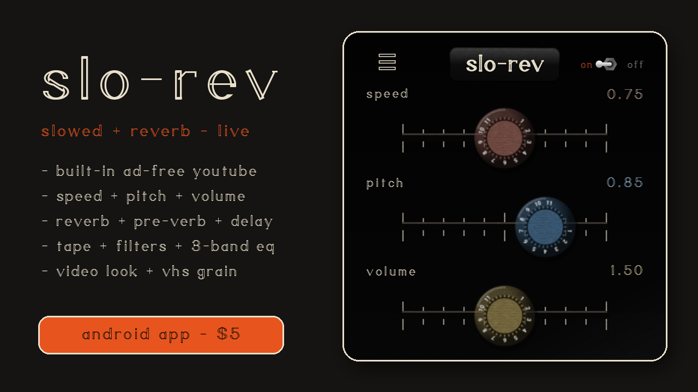

# slo-rev: slowed + reverb, live, on Android

slo-rev slows down and lowers the pitch of music while it plays, and adds reverb, echo, tape warmth and EQ. It has its own ad-free YouTube built in, and it also works on the sound of most other apps.

- **Download (free):** `slo-rev.apk` from [Releases](../../releases/latest), or `slo-rev.zip` from the [Ko-fi shop](https://ko-fi.com/katbokstudios/shop). Everything works for one day.
- **Keep it ($1):** buy the unlock code on [Ko-fi](https://ko-fi.com/katbokstudios/shop) and type it into slo-rev. It's yours for good.

## Install

1. On your Android phone (Android 10 or newer), download the APK file.
2. Open it from your notifications or the Downloads folder.
3. Android will ask whether to allow installs from this source (your browser or Files app). Tap **Settings**, turn on **Allow from this source**, and go back.
4. Tap **Install**. If Play Protect warns about an unknown app, tap **More details**, then **Install anyway**. slo-rev isn't on the Play Store, which is why the warning appears.

Had an earlier slo-rev demo? Installing this one updates it in place.

## Your free day and the unlock code

slo-rev works fully for one day from the first time you open it. The **ko-fi** button at the bottom of page 3 counts the time down.

1. When the day runs out (or whenever you tap the **ko-fi** button), Ko-fi opens and slo-rev shows a box for your **unlock code**.
2. Buy slo-rev on Ko-fi for $1. Ko-fi shows you the unlock code after paying.
3. Go back to slo-rev, type the code in the box and tap **Unlock**. slo-rev is now yours for good, and the ko-fi button goes away.

If you closed the box, open slo-rev again or tap the **ko-fi** button and it comes back.

## First start

slo-rev asks for three things the first time you open it:

1. **Microphone:** Android uses this permission for capturing the sound of other apps. slo-rev doesn't listen to the room.
2. **Notifications:** shows that slo-rev is running.
3. **Screen capture ("Start recording or casting"):** this is the only way Android lets an app hear other apps' sound. Choose **Entire screen** if you're asked. slo-rev never records or saves your screen. It only uses the sound.

If you tap "don't allow" by mistake, close slo-rev and open it again, or turn on Microphone for slo-rev in Settings > Apps.

## The built-in browser and ad blocker

Page 1 has YouTube built in, so you don't need another app.

- The browser runs on **Firefox's engine**. On the very first start, slo-rev downloads **uBlock Origin**, the ad blocker, from Mozilla's official add-on site and switches it on. This needs an internet connection for a few seconds. After that it stays installed, and there is nothing to set up.
- If the first start was offline, the ad blocker installs the next time you open slo-rev with internet.
- You can sign in to YouTube inside it the normal way, if you want your playlists.
- The picture is held back slightly so it lines up with the slowed sound. That is also why videos play at a smaller size (480p).

## Using it

slo-rev has five pages. Swipe left or right, or tap the **< >** arrows at the bottom.

| Page | What's on it |
|---|---|
| **1** | Speed, Pitch, Volume, and YouTube. Bottom left: the **full / exit** switch shows just the video. Bottom right: the **on / 432hz** switch. |
| **2** | The Low / Mid / High EQ |
| **3** | Reverb, Pre-verb, Decay, High pass, Low pass, Tape, Delay and Delay beat |
| **4** | The video on its own, with sliders for its look: Colour, Contrast, Saturation, Brightness and VHS Grain |
| **5** | More apps from KatBok Studios |

- The **on / 432hz** switch (bottom right of page 1): **432hz** plays the original song at normal speed with no effects, retuned to 432 Hz, and it fades smoothly between the two. Your knob settings stay as they are. slo-rev always opens on **on**.
- The **home** button (bottom right of pages 2 to 5) takes you straight back to page 1.
- Your settings are remembered, and so is the last YouTube page you were on.
- **Other apps:** leave slo-rev running and play music in another app. Its sound comes out processed.
- **Stopping:** swipe slo-rev away in your recent apps. Your normal volume comes back by itself.
- **Updates:** when a new version is out, slo-rev tells you when you open it.

## In the car

- Your car's Bluetooth can be on before or after you open slo-rev. It connects either way.
- When the car (or your headphones) disconnects, slo-rev pauses, so nothing starts playing out of your phone. Back in the car, press the car's **play** button to carry on.
- **Phone calls:** slo-rev pauses and steps aside while the phone rings and while you talk. When you hang up, it carries on where it was.

## Good to know

- While slo-rev runs, your phone's **media volume** is held at 0, and the processed sound plays on the **alarm volume**. Use slo-rev's VOLUME slider to set the level. If Do Not Disturb blocks alarms, you won't hear anything.
- With headphones, Android may also play alarm-volume sound through the speaker.
- Slowed sound gradually falls behind the original, so long songs drift. Skipping or starting a new video catches up.
- Some apps block other apps from hearing them, and slo-rev can't change their sound. **Spotify** is one of them, as are Netflix, Disney+ and Google Chrome. Use the built-in YouTube instead, or YouTube Music, Brave, Amazon Music or Deezer.
- **Privacy:** sound is kept only in slo-rev's private storage until it plays, and then deleted. Nothing is uploaded.

## More apps from KatBok Studios

- [Ko-fi shop](https://ko-fi.com/katbokstudios)
- [Burgerman](https://www.burgerman.co.za/)
- [Let's Talk](https://www.talksa.co.za/)
